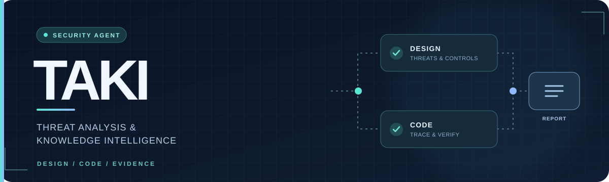

  
   
  
  <h1>너의 취약점은</h1>
  
<strong>스캔은 끝났는데, 권한 검사는 어디에 있나요?</strong>

설계서에는 관리자만 회원을 삭제할 수 있다고 적혀 있는데, 실제 API에는 권한 확인이 빠질 수 있습니다. **TAKI(Threat Analysis & Knowledge Intelligence)**는 설계서의 보안 요구사항을 코드와 대조하고, 있어야 할 통제가 구현됐는지 근거와 함께 보여주는 진단 에이전트입니다. 설계서가 없어도 코드의 진입점과 기존 보안 패턴에서 점검 항목을 찾습니다.

## 중점 진단

- SQL Injection
- 사용자 권한 검증 누락
- 고객정보 과다 노출
- 개인정보 보호 처리 누락

취약점마다 위치와 판정 근거, 수정 방향을 남깁니다. 최종 판단과 코드 수정은 사람이 맡습니다.

## 저장소

- [TAKI 진단 엔진](https://github.com/what-is-your-vulnerability/security-diagnosis-agent) — CLI와 정적 진단
- [TAKI 서버](https://github.com/what-is-your-vulnerability/taki-server) — 로컬 API, worker, 결과 저장
